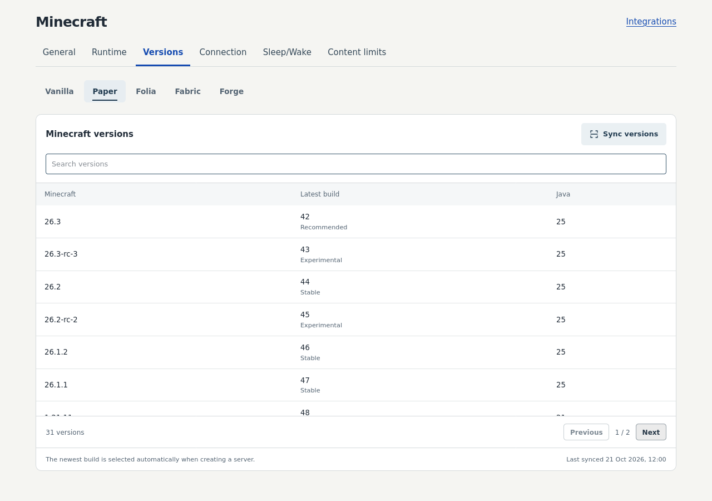
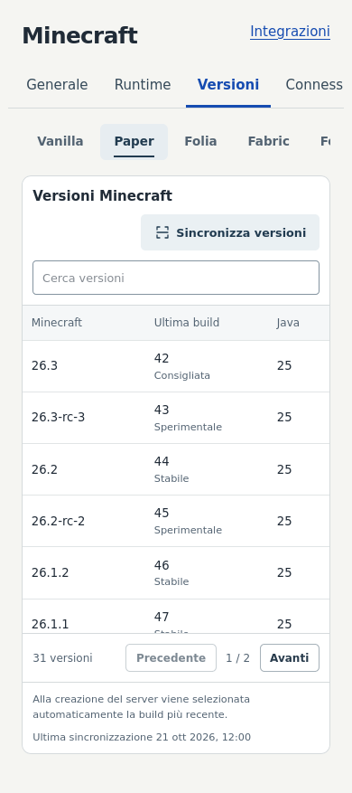
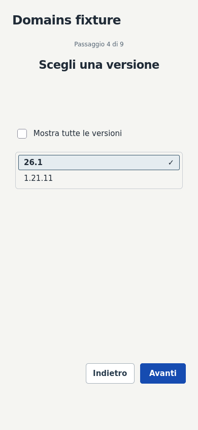

# M5 Paper runtime

Users choose Minecraft → Paper → Minecraft version. The newest build in the
accepted local catalog is selected automatically and frozen for that creation;
existing servers and idempotent retries retain their original build.

## Owner setup

1. After migration048, open Minecraft integration → Versions → Paper. The worker
   populates the local catalog automatically; **Sync versions** queues a refresh.
2. In Runtime, associate Paper with the existing PaperUpdated egg and chosen
   managed node. Choose **Defined by integration** for the image. This action is
   deliberately left to the Owner. The egg must advertise the required ptero-eggs
   Java image and its version/build/JAR variables.
3. Enable the mapping and the intended Minecraft rollout. Paper becomes available
   in the ordinary creation wizard. Build selection requires no maintenance.

The [runtime contract](GAME-INTEGRATIONS.md#paper-catalog-and-creation) documents
image ranges, exact bindings and cache behavior. No Blueprint update is needed.

## Validation

- Public Fill metadata:68 Minecraft versions,137 JSON requests,117,906 bytes,
  3.197s initial fetch. Refresh:69 requests,66,540 bytes,1.089s; all68 build documents
  reused and identical accepted snapshot. Snapshot171,522 bytes. No JAR downloaded.
- Unit:63 upstream/runtime/egg/Java/image tests,21 compatibility/Gateway tests,
  9 worker tests.
- Isolated integration:60 registry/Fabric/Paper/API tests,14 Gateway cases,
  17 provider-cache cases,2 installation-artifact cases. No real game mutations.
- Firefox:9 Owner-catalog and Fabric/Paper wizard tests, EN/IT desktop/mobile;
  keyboard/accessibility checks and screenshot review.
- Root/frontend TypeScript, Biome, translation consistency and web build.
  Existing nonblocking lint warnings and large-chunk build warnings remain.
- Independent review covered backend authority/snapshots and upstream/UI contracts.
  It found and corrected prerelease ordering; real metadata exposed legitimate
  historical build0, now covered by regressions.

These results validate discovery/provisioning contracts and simulated protocols.
They do not certify all historical Paper builds or replace the first actual
Owner-driven installation/play test.

## Screenshots

Isolated browser fixtures render real application components; no personal/provider
configuration is shown.

Additional states: [loading](screenshots/m5/paper-catalog-loading-en.png),
[empty](screenshots/m5/paper-catalog-empty-en.png),
[queued](screenshots/m5/paper-catalog-queued-en.png),
[error](screenshots/m5/paper-catalog-error-en.png).

## Activation and rollback

The additive migration048 needs explicit dev approval and the existing full Compose
chain. Source hot reload handles API/worker/UI; the Gateway must reload its new
compiled declaration. No new ports, routes, mappings, game servers or provider
settings are created by activation. No production deployment or M6 work.

Rollback only this change and retain the additive Paper catalog/schema. Preserve
all game/profile/runtime records. Once Paper servers exist, retain Paper-capable
code pending review rather than reverting their supported runtime.

## Development activation — 2026-10-21

Owner-approved activation applied only migration048. The existing worker populated
all68 Paper versions automatically and scheduled the next refresh15minutes later.
Only the development Gateway was restarted to load the compiled Paper declaration;
API/worker/UI used their existing development reload path.

Authenticated Firefox checks on the real development app passed: HTTPS200,
Paper catalog200 with68versions, secure HMR, no JavaScript errors or horizontal
mobile overflow. All11 development containers are healthy; their IDs, images,
mounts, networks and ports are unchanged. Panel/Wings were neither changed nor
restarted. Existing accounts, managed servers and mappings were preserved.
No Paper mapping or game server was created: the Owner setup above is the next step.

## Initial properties template regression — 2026-10-21

The first Owner Paper installation exposed an incomplete-template case:
PaperUpdated installs a `server.properties` containing only `server-port` and
`server-ip`. Wings successfully installed the exact catalog JAR, but NickHosting
rejected the wizard's `white-list` setting because it treated the initial file as
the complete list of supported properties. Reinstalling repeated the same error
in the configuration phase.

Initial configuration now combines properties already present with the verified
report and the integration's declared player-management support for `white-list`.
It can append the missing bootstrap property while preserving the egg's existing
values. Ordinary settings validation and protected-property restrictions remain
unchanged. This correction requires neither an egg change nor a provider update.
Failed operation history is retained; the Owner can retry using **Reinstall**.
Both whitelist states reproduce the original failure and pass after the fix,
including operator/whitelist files and preservation of the template's bind values.
Seven focused lifecycle integration tests and29 properties/player tests pass;
root TypeScript and targeted Biome checks pass. Actual reinstallation remains an
Owner-driven check; no game files or provider settings were manually changed.
