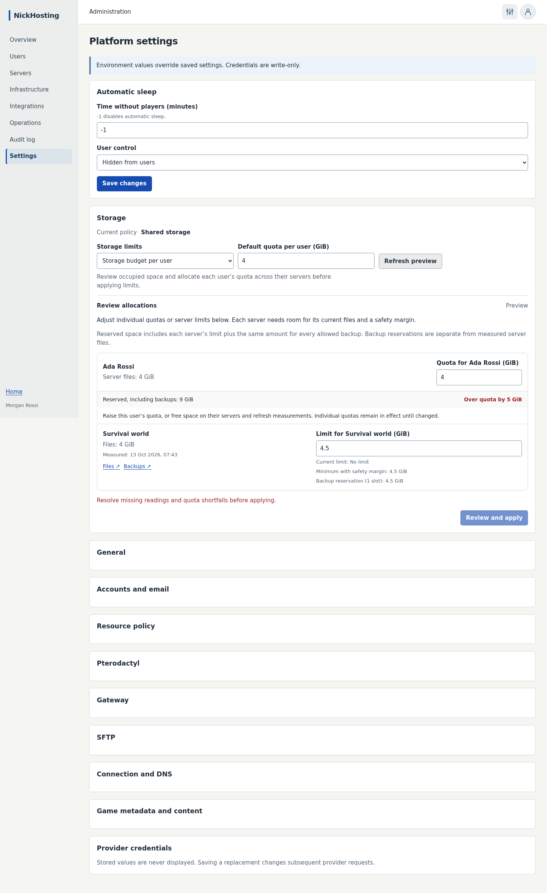
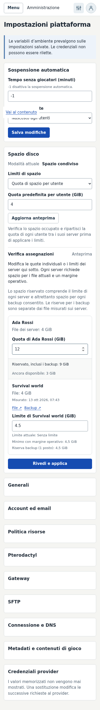
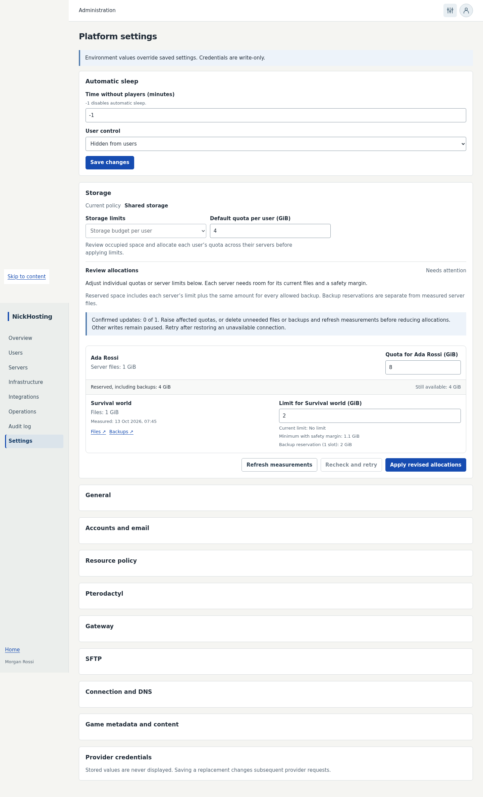
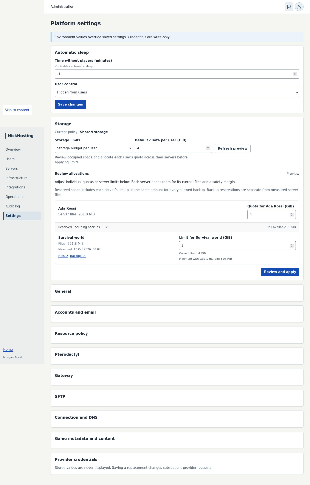

# M5 storage policy and recovery validation — 2026-10-13

Shared storage now creates provider disks with cap `0`. Server cards show occupied
Wings disk bytes, with loading/unavailable states, rather than the old configured
4096 MiB allowance. Existing finite caps change only when the Owner explicitly
applies a storage plan from **Administration → Settings → Storage**.

The Owner can preview personal budgets, inspect affected users, adjust server
allocations and persistent user exceptions, then confirm application. Reservations
include backup slots and a growth margin. Actual retained backup size is also
charged against physical capacity after live files shrink. The global policy is
committed only after provider and SFTP quota readback confirm every server.

Partial application remains durable. Only file/backup deletion is permitted while
blocked; refresh remeasures the same plan without effects, preserves the uncertain
effect ledger and unsaved UI allocations, and requires explicit resume. Default
followers remain distinct from permanent exceptions and legacy compute expiry.

## Evidence

All commands use Node 24.21.0 and pnpm 10.33.0. Integration/browser tests use the
existing isolated M2 services through `pnpm exec tsx scripts/test-env.ts --m2`;
no live game server is used or mutated by these checks.

- Storage transition integration: 20 cases covering missing measurements,
  budgets, provider/SFTP uncertainty, progress persistence, changed inventory,
  pending operations/uploads, physical capacity, blocked cleanup/refresh, legacy
  exceptions, environment overrides and follow-default semantics.
- Fresh observation integration: 17 cases passed, covering scoped admission, retained backups,
  invalid/incomplete/stale evidence, identity/configuration drift and bounded
  concurrency; 3 physical accounting cases passed, covering large retained backups after
  file deletion and fail-closed missing measurements.
- Admission, registry, platform queries and actual platform HTTP handlers cover
  unlimited creation, finite quota validation and protected transition endpoints.
- Existing lifecycle reconciliation: 38 selected cases passed. Copy/extract file
  operations: 34 cases passed. Targeted actual HTTP checks verify unlimited
  uploads and blocked-only cleanup without permitting writes or unauthorized access.
- Actual isolated SFTPGo test verifies cap `0`, finite restoration using verified
  occupancy, and preservation of the password/expiry. Existing issue #18 remains
  a separate production-release gate.
- Storage UI: 8 browser cases passed, including the 4 GiB over-budget scenario,
  failed refresh, 1 GiB after cleanup, draft retention, explicit resume, unavailable
  readings, confirmation, read-only roles and environment locks. Desktop/mobile
  screenshots were reviewed; axe WCAG 2.2 AA checks passed.
- Home checks verify whole-card navigation, keyboard tooltip/focus and actual
  measured disk usage. Root/API/worker and web typechecks, compiled EN/IT catalogs
  and repository lint passed (lint retains 37 warnings and 2 informational diagnostics).
- Independent review resolved cleanup/refresh recovery, exception/default semantics,
  actual backup accounting, environment precedence, scoped admission and routine
  telemetry races; no remaining actionable findings within the reviewed storage scope.
- Existing Minecraft HTTP integration: 19 cases passed. Platform browser journeys:
  10 passed in the final complete run; the remaining operator case passed in a
  focused rerun after correcting its disabled-button assertion and ensuring its
  locale reset works independently of earlier journeys. No final 11-case rerun is
  claimed. Earlier fixture corrections retained the actual navigation, access and
  settings-mutation assertions.

Representative commands (integration/browser commands are prefixed by the isolated
wrapper above):

```sh
pnpm typecheck
pnpm lint
pnpm i18n:check
pnpm exec vitest run --config vitest.integration.config.ts packages/server-management/src/storage-policy.integration.test.ts packages/server-management/src/storage-observations.integration.test.ts
pnpm exec vitest run --config vitest.browser.config.ts apps/web/tests/storage-policy-ui.browser.test.ts
pnpm exec vitest run --config vitest.browser.config.ts apps/web/tests/platform.browser.test.ts
pnpm exec vitest run --config vitest.browser.config.ts apps/web/tests/platform.browser.test.ts -t 'gives platform operators'
python3 scripts/check-governance.py
```

The repository-wide unit run passed 2104 of 2110 tests. Five content staging tests
hit the host's existing minimum-free-space policy (60 GiB available on a 756 GiB
filesystem, below its 10% margin); the remaining game UI test expects a modpack
picker absent from the current creation descriptor. These unrelated product paths
and infrastructure were not changed to bypass their checks.

## Screenshots

These contain only isolated browser fixture identities.







## Development activation and rollback

Additive migrations `026` and `027` were applied to the verified NickHosting
development database. They do not change existing provider caps or initiate a
transition. The Owner authorized one `docker restart --time 15
nickhosting-dev-api-1` to recover blocked graceful hot reload; API and worker
health were verified afterward. No Pterodactyl/Wings restart, configuration change,
existing game file mutation or real test-server creation/cleanup was performed.

Keep the additive tables/column when reverting application code. Never revert
the transition implementation while a plan is applying or blocked: finish its
verified reconciliation first. Restoring a previous storage policy requires an
explicit reviewed plan; changing only the global flag would misrepresent provider
and SFTP limits. Private notes, credentials and Mailpit messages are not included
in repository evidence.

## GiB arrow-step correction — 2026-10-13

With 251.8 MiB occupied, the computed minimum is 380 MiB (0.37109375 GiB).
Firefox aligns native number-input arrows to the HTML minimum even with
`step="any"`, so decrementing 4 produced 3.37109375. All three storage GiB inputs
now use a zero step base. Positive-size and measured-minimum validation remain
separate and still block unsafe application; manually entered fractional GiB
remain supported at whole-MiB precision. No backend, quota policy or migration changed.

The new browser regression failed before the fix and passed after it in both
Firefox and Chromium: all three fields step 4 → 3 → 4 as appropriate, a 0.25 GiB
disk below the 380 MiB minimum blocks application, and a zero user quota also
blocks application. Each focused run passed 1 case with 8 unrelated cases filtered;
the complete suite was not repeated. Web and browser-test typechecks, scoped Biome,
diff checks and independent review passed. Commands:

```sh
NH_BROWSER=firefox pnpm exec vitest run --config vitest.browser.config.ts apps/web/tests/storage-policy-ui.browser.test.ts -t 'steps whole GiB'
pnpm exec vitest run --config vitest.browser.config.ts apps/web/tests/storage-policy-ui.browser.test.ts -t 'steps whole GiB'
pnpm --filter @nickhosting/web typecheck
```

No infrastructure, database or real server operations; no test assets created or
deleted. Rollback is a source-only revert, retaining existing storage safety checks.
Review the server limit with native arrows and typed decimal values in Owner Settings.


